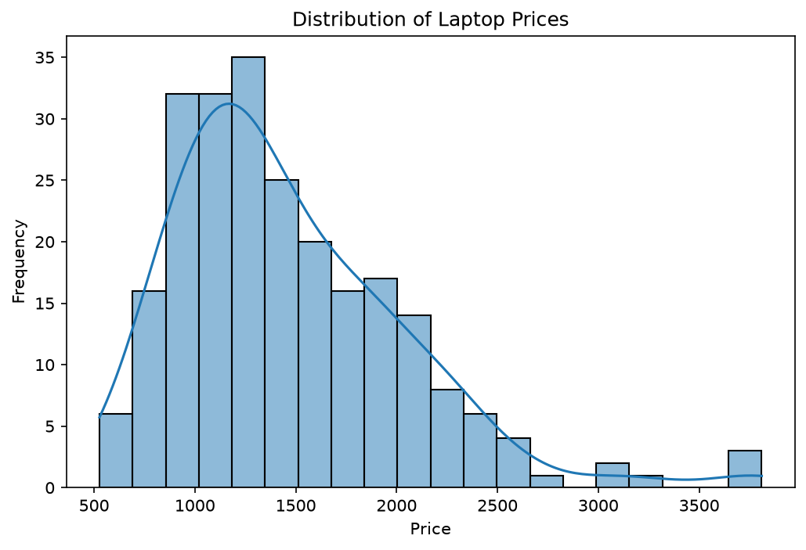
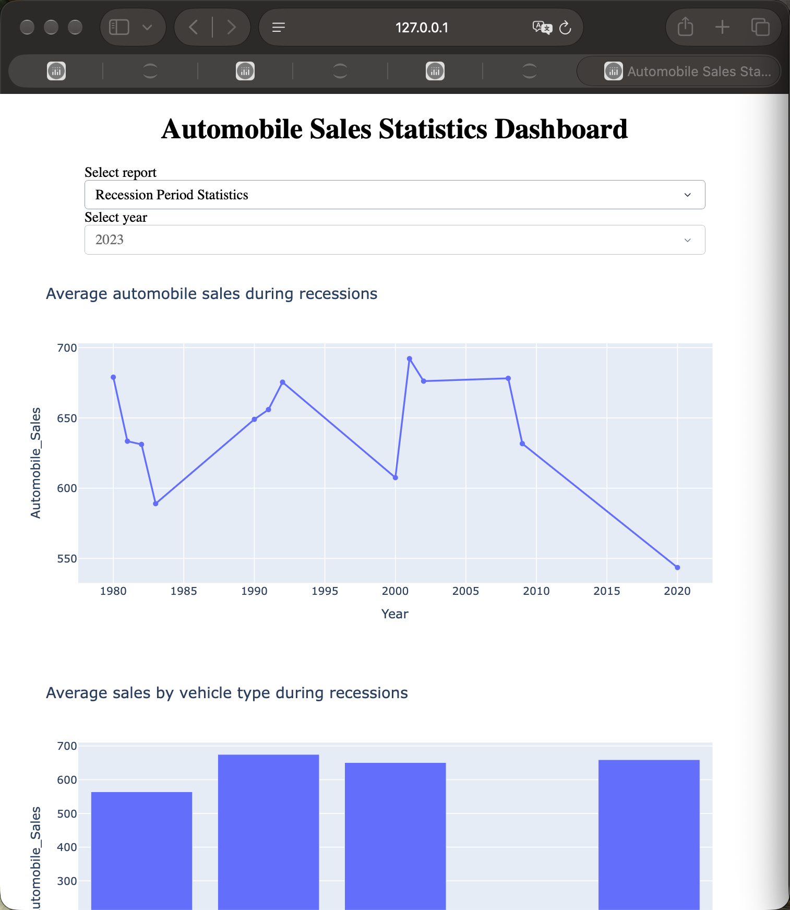

# Xie Yihan | Data Science Portfolio

I am developing data analysis and visualization skills through CISC7204 coursework. These course-derived projects show how I connect research questions, evidence and limitations.

**Skills:** Python, pandas, NumPy, Matplotlib, Seaborn, statistical exploration, Plotly and Dash.

## King County House Prices
**Research question:** How do area and waterfront status relate to house sale prices?

**Main finding:** Above-ground area and price have a positive correlation of 0.606. Waterfront median prices are higher.

**Limitation:** Historical 2014–2015 observations and a small waterfront group cannot establish causality or current market prices.

**Status:** Completed descriptive analysis; rerun verified.

[Code and documentation](https://github.com/LiviaFragmo/data-science-project)

## Laptop Pricing
**Research question:** How do hardware attributes and manufacturer groups relate to price?

**Main finding:** In 238 records, prices are right-skewed (skewness 1.274), and RAM is positively associated with price (correlation 0.549).

**Limitation:** A small teaching sample and unequal manufacturer groups limit generalization; associations do not establish causation.

**Status:** Completed exploratory analysis; rerun and four exported charts verified.

[Code and run instructions](https://github.com/LiviaFragmo/data-science-project/blob/main/laptop-pricing_README.md)

## Automobile Sales Dashboard
**Research question:** How do sales patterns vary between recession periods and selected years?

**Main finding:** The teaching data shows average sales of about 649 during recession observations versus 2,817 in other observations.

**Limitation:** Descriptive comparisons in an instructional dataset cannot establish causal effects or represent a real manufacturer.

**Status:** Completed dashboard; HTTP endpoints, report callbacks and year controls verified.

[Code and run instructions](https://github.com/LiviaFragmo/data-science-project/blob/main/automobile-dashboard_README.md). The interactive Python dashboard runs locally or on a compatible Python host; this site displays its screenshots.

## Reproducibility and acknowledgment
[Validation details](https://github.com/LiviaFragmo/data-science-project/blob/main/reproduction-report.md)

Projects derive from CISC7204 coursework and IBM Skills Network resources. Source CSVs are read from the provider or an authorized local copy; raw course data is not republished. AI assisted organization, documentation, code revisions and validation. Classmate review is pending.
